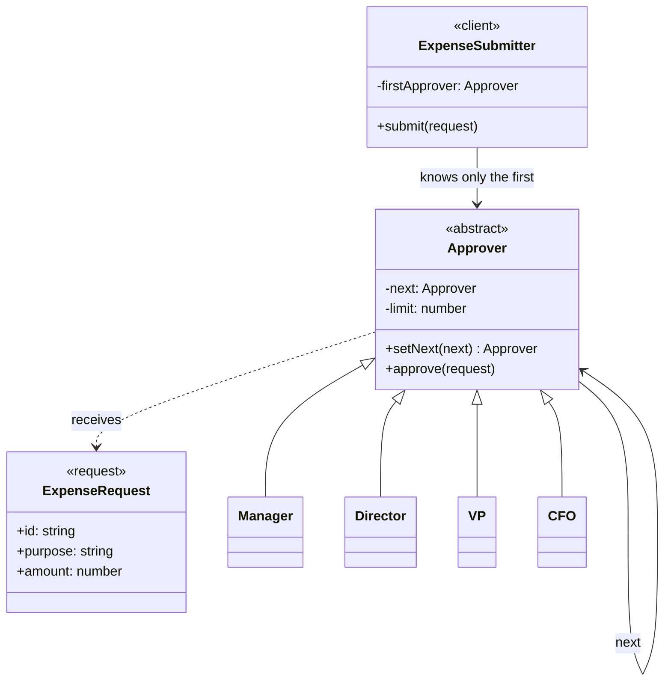
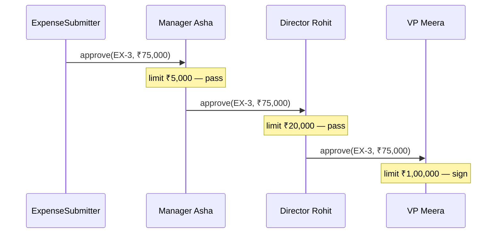

# Chain of Responsibility — Expense Approval

> Preview with **Cmd / Ctrl + Shift + V**
>
> **Code:** [`chain.ts`](./chain.ts) — run with `npm run demo:chain`

---

## Problem statement

Employees submit expenses. The company signs them by amount:

| Expense | Amount | Who should sign |
| ------- | ------ | --------------- |
| Team lunch | ₹1,200 | Manager (limit ₹5,000) |
| Conference ticket | ₹18,000 | Director (limit ₹20,000) |
| Team offsite | ₹75,000 | VP (limit ₹1,00,000) |
| Office acquisition deposit | ₹5,00,000 | Nobody, until a CFO (limit ₹10,00,000) is added |

The submit screen has one job: hand the expense to the start of the approval line. It must not contain limits, job titles, or a branch per role. When finance hires a CFO, the lunch screen stays as it was.

---

## Without the chain

```typescript
function badApprove(request: ExpenseRequest): void {
  if (request.amount <= 5_000) {
    // Manager Asha signs
  } else if (request.amount <= 20_000) {
    // Director Rohit signs
  } else if (request.amount <= 100_000) {
    // VP Meera signs
  } else {
    // rejected — a CFO would be another branch in this function
  }
}
```

| Issue | What it costs |
| ----- | ------------- |
| Policy lives in the sender | Every screen that submits an expense learns every limit |
| New role | Edit the ladder. A copied ladder must be edited too |
| Order is fragile | The branches only work written smallest-first. Swap them and the VP signs a ₹1,200 lunch |
| Can't ask one approver | "Would the manager sign this?" is not a separate object |
| Rejection is a leftover `else` | "Nobody can sign this" is not a real end of a line, it is the branch you didn't write |

The demo rejects the ₹5,00,000 deposit here. Signing it means editing `badApprove()`.

---

## UML



**Reading the UML:** `ExpenseSubmitter` has one arrow, to `Approver`. It does not point at `Manager` or `CFO`. The loop from `Approver` to `Approver` is the chain built with `setNext()`. `CFO` is the same kind of box as `Manager` — adding it does not change the submitter.

---

## The handler

```typescript
approve(request: ExpenseRequest): void {
  if (request.amount <= this.limit) {
    // sign — do not call next
    return;
  }
  if (this.next) {
    this.next.approve(request);
    return;
  }
  // last in line, and it is over my limit → reject
}
```

Concrete approvers only supply a title, a name, and a limit:

```typescript
class Manager extends Approver {
  constructor(name: string) {
    super("Manager", name, 5_000);
  }
}
```

A handler with a different kind of rule — "I only sign travel" — would replace the amount check. The forwarding stays in `Approver`.

---

## Building the chain

```typescript
const manager = new Manager("Asha");
const director = new Director("Rohit");
const vp = new VP("Meera");

manager.setNext(director).setNext(vp);
// manager → director → vp

new ExpenseSubmitter(manager).submit({
  id: "EX-3",
  purpose: "Team offsite",
  amount: 75_000,
});
```

`setNext()` returns the handler you just attached, not the one you called it on. `manager.setNext(director)` returns `director`, and the next `.setNext(vp)` runs on the director. If `setNext()` returned `this`, both links would sit on the manager and the director would never see a request.

---

## One request walking the chain



The submitter does not call the director or the VP. Each handler decides.

| Request | Where it stops |
| ------- | -------------- |
| Lunch ₹1,200 | Manager signs. Director is never called |
| Conference ₹18,000 | Manager passes. Director signs |
| Offsite ₹75,000 | Manager and Director pass. VP signs |
| Deposit ₹5,00,000 | All three pass. The VP has no `next`, so the request is rejected |

---

## Adding the CFO

```typescript
vp.setNext(new CFO("Kabir")); // limit ₹10,00,000
submitter.submit(deposit);    // same submitter, same first link
```

`Manager`, `Director`, `VP`, and `ExpenseSubmitter` are not edited. The deposit now stops at Kabir. That is the Open/Closed win over the `else if` ladder: the new role is a new link, not a new branch.

---

## What you gain

| | `if / else if` ladder | Chain |
| -- | --------------------- | ----- |
| Who knows the limits | The function that submits | Each approver knows its own |
| Add a CFO | Edit the ladder | One new class, one `setNext()` |
| Submitter's knowledge | Every title | The first handler |
| A request nobody can sign | A final `else` | Falls off the last link and is rejected out loud |
| Reorder who goes first | Rewrite branches, carefully | Rewire `next` |

---

## Other places this exact shape appears

- **Support desk** — billing desk handles invoices, tech desk handles bugs, engineering handles outages. The form submits to the front desk.
- **Express / Koa middleware** — auth, then rate limit, then validation. A layer that sends a response does not call `next()`. Layers that only annotate the request do call `next()`, which is a common variant of this pattern rather than a different one.
- **A click in the DOM** — the event walks child → parent → document until a listener calls `stopPropagation()`.
- **Log levels** — a DEBUG handler ignores an ERROR line, or writes it and stops, depending on how that framework defines "handled".

If every handler must run to completion, this is the wrong pattern. Nothing in an expense chain should both sign the expense and also ask the next person to sign it.

---

## Run it

```bash
npm run demo:chain
```

The demo first runs the `if / else if` ladder and rejects the ₹5,00,000 deposit. It then runs the same four expenses through Manager → Director → VP. The deposit is rejected again, because the VP is the last link. Linking a CFO and resubmitting signs it, without any change to the submitter.
