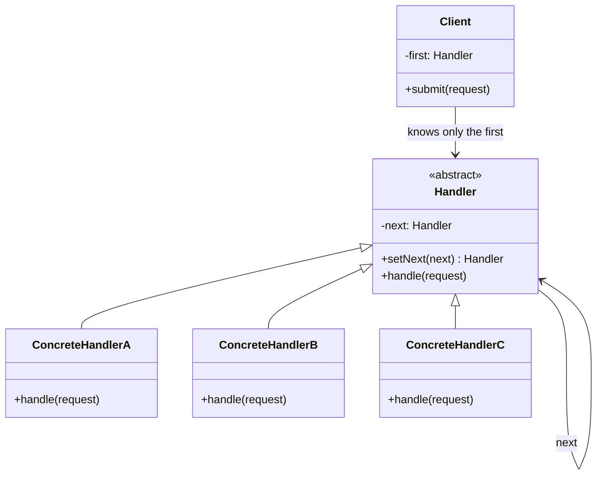
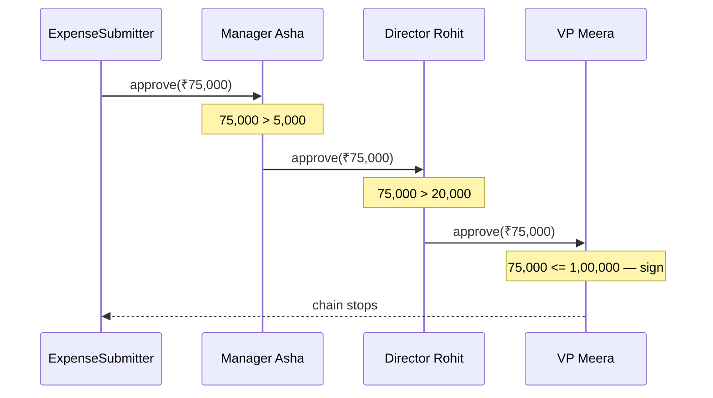

# Chain of Responsibility — Understanding the Idea

> Preview with **Cmd / Ctrl + Shift + V**

---

## Definition

> **Chain of Responsibility** is a behavioral design pattern that passes a request along a **chain of handlers**. Each handler decides: **deal with it, or forward it**. The sender holds only the first handler and never names the one that ultimately does the work.

In plain words:

> _"An employee submits an expense to the manager. The manager signs what fits their limit and passes the rest up. The employee does not keep a list of who is allowed to sign what."_

---

## A use-case-specific pattern

This pattern fits one shape of problem. Strategy, Factory, and Observer show up all over an app. A chain of handlers does not.

Use it only when **all three** of these are true:

1. **Several candidates might handle the request.** A manager, a director, or a VP could be the right signer.
2. **Each candidate has a rule for "this one is mine" vs "pass it on".** The rule here is an amount limit. It can just as well be a topic, a role, or a status code.
3. **The sender must not know which candidate will handle it.** Adding a CFO should not force every submit button to learn a new name.

If you always know the exact receiver, call it. If every handler must run, you do not want a chain that stops — you want a pipeline.

---

## The problem statement

A company reimburses expenses. Who signs depends on the amount:

| Amount | Who can sign |
| ------ | ------------ |
| Up to ₹5,000 | Manager |
| Up to ₹20,000 | Director |
| Up to ₹1,00,000 | VP |
| Up to ₹10,00,000 | CFO (added later) |
| Above that | Nobody — the request is rejected |

An employee submits "Team lunch, ₹1,200" or "Office deposit, ₹5,00,000". The submit screen should not contain the org chart. A new signing role should be a new class linked into the chain, not a new branch in every screen that submits an expense.

---

## The issue without the chain

The first version is one function that knows every limit:

```typescript
function badApprove(request: ExpenseRequest): void {
  if (request.amount <= 5_000) managerSigns();
  else if (request.amount <= 20_000) directorSigns();
  else if (request.amount <= 100_000) vpSigns();
  else reject();
}
```

What goes wrong:

1. **The sender knows the whole policy.** The function that submits an expense also knows every title and every limit. That policy now leaks into every screen that copies the function.
2. **A new role edits existing code.** A CFO is another `else if`, in every copy. That breaks Open/Closed.
3. **The order is a hidden assumption.** The branches only work because they are written smallest-limit first. Swap two branches and a ₹1,200 lunch is signed by the VP.
4. **Handlers cannot be reused.** "Can the manager sign this?" is not a question you can ask on its own. The rule lives inside the ladder.
5. **There is no end of the chain.** Rejection is just the final `else`. When nobody can sign, that fact is buried in the same function as the approvals.

---

## How the chain fixes it

Each approver is an object with a limit and a link to the next approver:

```typescript
approve(request: ExpenseRequest): void {
  if (request.amount <= this.limit) {
    // sign it — the chain stops here
    return;
  }
  if (this.next) {
    this.next.approve(request); // not mine
    return;
  }
  // I am the last link and it is over my limit
}
```

The employee is given the manager and calls `approve()`. A ₹1,200 lunch stops at the manager. A ₹75,000 offsite passes the manager and the director and stops at the VP. A ₹5,00,000 deposit falls off the end until a CFO is linked after the VP — with no change to the manager, the director, the VP, or the submitter.

`setNext()` returns the handler just attached, so this builds manager → director → VP:

```typescript
manager.setNext(director).setNext(vp);
```

Returning `this` instead would attach both links to the manager and drop the director. The order of the chain is the order of the links, not the order of `if` branches.

---

## Standard UML



**Reading the UML:** the client points at `Handler`, not at a concrete approver. Each concrete handler extends the base and inherits the "handle or forward" method. The arrow from `Handler` back to `Handler` is the chain: a handler holds the next one, which holds the next one.

| Role | Meaning | In our example |
| ---- | ------- | -------------- |
| **Client** | Starts the request, knows only the head | `ExpenseSubmitter` |
| **Handler** | The link: a rule plus a `next` | `Approver` |
| **Concrete handler** | One candidate, with its own limit | `Manager`, `Director`, `VP`, `CFO` |
| **Request** | The thing being passed along | `ExpenseRequest` |

---

## Core flow

A ₹75,000 offsite, limit of the VP:



The submitter makes one call. Two handlers decline by forwarding. The third signs, and nobody after the VP is asked.

---

## Where this shape shows up

The expense ladder is one example. The same shape is a request offered to a line of candidates:

| Domain | Request | Each handler's rule | Chain stops when |
| ------ | ------- | ------------------- | ---------------- |
| **Expense / leave / purchase approval** | "Please sign this" | Amount or duration is within my authority | Someone signs, or the last person rejects |
| **Support desks** | A ticket | "Billing is mine", "Outages go to engineering" | The first desk that owns that topic |
| **HTTP middleware** (Express, Koa) | An incoming request | Auth, rate limit, validation | A layer sends the response and does not call `next()` |
| **UI event bubbling** (DOM) | A click | "I have a listener for this" | A listener calls `stopPropagation()` |
| **Logging frameworks** | A log line | My level is DEBUG / INFO / ERROR | The line is written, or filtered out |
| **Technical-support escalations** | "I can't fix this" | Known issue vs needs an engineer | Someone resolves it |
| **Filters in a security stack** | A call or a packet | Allow, deny, or I don't recognize it | A filter denies, or the request is allowed through |

Two of these deserve care, because people meet them early and they are only *partly* this pattern:

- **Express middleware** is a chain, but a layer often does some work **and** calls `next()`. Classic Chain of Responsibility has one handler do the work and stop. Both are the same idea — a linked list of handlers the sender does not configure one by one — with a different rule for stopping.
- **DOM bubbling** walks a chain that already exists (child → parent → document). You don't build it with `setNext()`. You only choose where to stop.

---

## When NOT to use it

| Situation | Why a chain is the wrong tool | Use this instead |
| --------- | ----------------------------- | ---------------- |
| You always know the receiver | The chain hides a call you could make directly | Call that object |
| Every handler must run, in order | Nothing here should "stop the chain" | **Template Method**, or a plain list of steps |
| Handlers are alternative algorithms for the same job, and you pick one up front | You are choosing, not forwarding | **Strategy** |
| Any number of listeners should hear the same event | A chain stops; listeners should all be told | **Observer** |
| Two branches, and they will stay two branches | A linked list is more machinery than the `if` | The `if` |

---

## Chain of Responsibility vs the neighbours

| | Chain of Responsibility | Strategy | Observer | Decorator |
| -- | ----------------------- | -------- | -------- | --------- |
| How many objects run? | The first one whose rule matches | The one you picked | All of them | All of the wrappers |
| Who chooses? | Each handler, at the moment the request arrives | The client, before the call | Nobody — everyone subscribed | The client, when it stacks wrappers |
| Can you reorder without editing them? | Yes — change the `next` links | You swap one object, there is no order | Order usually does not matter | Yes — wrap in a different order |
| Example | Manager passes a ₹75,000 expense up | Card vs UPI, chosen at checkout | Weather station tells every display | Milk wraps coffee and both `cost()` methods run |

---

## SOLID connection

| Principle | How the chain helps |
| --------- | ------------------- |
| **S** | Each approver knows one limit. The submitter knows none of them |
| **O** | A CFO is a new class plus one `setNext()`. `badApprove()` would grow a branch |
| **D** | The submitter depends on `Approver`, not on `Manager` or `CFO` |

**A caution:** a request can fall off the end with nobody handling it. That needs an explicit last step (the rejection message in `Approver`), not a silent return. Also, a very long chain of one-line handlers is harder to follow than the policy table it replaced — use the chain when the handlers are real objects with a reason to exist apart from the ladder.

---

## Lesson in this folder

| Resource | What |
| -------- | ---- |
| [chain.md](./chain.md) | Expense approval walkthrough |
| [chain.ts](./chain.ts) | One `if / else if` ladder vs a chain, then a CFO linked in |

```bash
npm run demo:chain
```

---

## One-liner

> _"Pass the request down a line of handlers; each one signs it or forwards it, and the sender never learns who was allowed to sign."_
