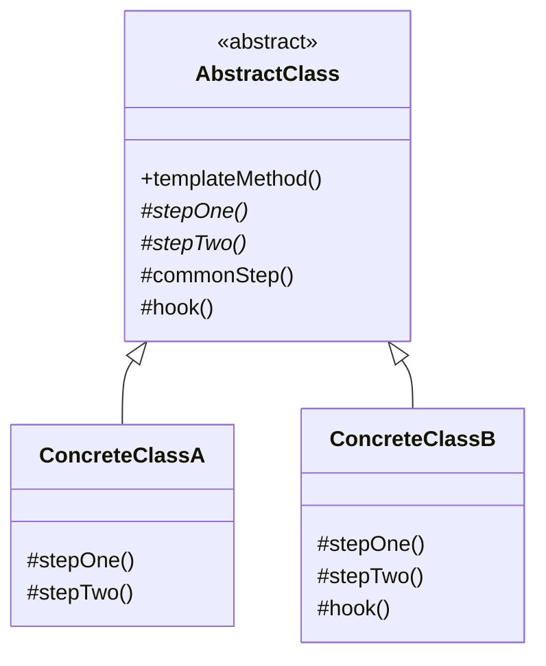

# Template Method Pattern — Understanding the Idea

> Preview with **Cmd / Ctrl + Shift + V**

---

## Definition

> **Template Method** is a behavioral design pattern where a base class defines the **skeleton of an algorithm** — the steps and their order — in one method, and lets subclasses fill in **only the steps that differ**.

In plain words:

> _"The recipe is fixed: read, parse, validate, save, report. A CSV importer and a JSON importer only disagree on how to **parse**. So write the recipe once, and let each importer supply its own parsing step."_

The method that holds the recipe is called the **template method**.

---

## A use-case-specific pattern

Patterns like Strategy and Factory show up in almost every codebase. **Template Method is narrower.** It solves one specific shape of problem, and outside that shape it adds nothing but inheritance.

Use Template Method only when **all three** of these are true:

1. **Several variants run the same process.** CSV, JSON, and XML importers all import employees.
2. **The steps and their order are fixed.** Every variant must read → parse → validate → save → report, in that order, with no exceptions.
3. **Only some steps differ.** Parsing changes per format; validation, saving, and reporting are identical.

If the order of steps changes between variants, or nothing is shared between them, Template Method is the wrong tool.

---

## The problem statement

Your HR platform imports employee records from files that customers upload. Customers send different formats — CSV today, JSON from a newer partner, XML from a legacy payroll system next quarter.

Every import must:

1. Read the file.
2. Parse it into employee records (**differs per format**).
3. Reject invalid rows — missing ID or bad email (**same for all**).
4. Save the valid rows to the database (**same for all**).
5. Print a summary of imported vs rejected rows (**same for all**).
6. Optionally notify HR (**some formats only**).

The order matters: saving before validating would put bad data in the database.

---

## The issue without Template Method

The natural first attempt gives each format its own importer class, each with its own full `import()` method:

```typescript
class CsvImporter {
  import(path) {
    read(path);
    parseCsv();
    validate();      // copied
    save();          // copied
    printSummary();  // copied
  }
}

class JsonImporter {
  import(path) {
    read(path);
    parseJson();
    // validate() was forgotten here
    save();          // copied
    printSummary();  // copied, slightly different wording
  }
}
```

What goes wrong:

1. **Duplicated pipeline** — the shared steps are copied into every importer. Changing the database or the summary format means editing every class.
2. **Steps drift apart** — over time the copies stop matching. One importer formats the summary differently; another adds a check the others don't have.
3. **Steps go missing** — nothing forces every importer to validate. In the demo, the JSON importer saves a record with an empty ID because validation was never copied over.
4. **The order isn't guaranteed** — each class can run the steps in its own order, including saving before validating.
5. **New formats are expensive** — an XML importer means copying the whole pipeline a third time.

---

## How Template Method fixes it

Move the pipeline into an abstract base class, written once:

```typescript
abstract class DataImporter {
  importFile(path: string): void {      // the template method
    const raw = this.readFile(path);
    const records = this.parse(raw);    // ← subclass decides
    const valid = this.validate(records);
    this.save(valid);
    this.printSummary(records.length, valid.length);
    if (this.shouldNotifyHR()) { /* ... */ }  // ← optional hook
  }

  protected abstract parse(raw: string): EmployeeRecord[];
  // readFile, validate, save, printSummary are implemented here once
}
```

Each importer now writes **only** its parsing step. The base class owns the order, so no importer can skip validation or save too early.

---

## Three kinds of steps

| Kind | Who implements it | In our example |
| ---- | ----------------- | -------------- |
| **Abstract step** | Every subclass **must** implement it | `parse()`, `formatName()` |
| **Concrete step** | The base class, once, for everyone | `readFile()`, `validate()`, `save()`, `printSummary()` |
| **Hook** | The base class gives a default; subclasses **may** override | `shouldNotifyHR()` — default `false`, JSON returns `true` |

Hooks are how you add optional behaviour without breaking the fixed order.

---

## Standard UML



**Reading the UML:** `templateMethod()` is public and calls the steps in a fixed order. Steps marked `*` are abstract — each subclass must implement them. `commonStep()` is written once in the base. `hook()` has a default that a subclass can override (like `ConcreteClassB`). The client calls only `templateMethod()`.

| Role | Meaning | In our example |
| ---- | ------- | -------------- |
| **Abstract class** | Holds the template method and shared steps | `DataImporter` |
| **Template method** | Fixes the order of steps | `importFile()` |
| **Concrete class** | Implements the steps that differ | `CsvImporter`, `JsonImporter`, `XmlImporter` |

---

## Core flow

```
csvImporter.importFile("employees.csv")      ← defined once in DataImporter
        │
        ├── readFile()          base class
        ├── parse()             CsvImporter   ← the only CSV-specific code
        ├── validate()          base class
        ├── save()              base class
        ├── printSummary()      base class
        └── shouldNotifyHR()    hook → false (default)
```

The control flow lives in the parent and calls **down** into the child for specific steps. This is sometimes called the **Hollywood Principle**: _"Don't call us, we'll call you."_ The subclass never decides when its step runs.

---

## Where Template Method is used in real life

Because it needs a fixed sequence of steps, its use cases are specific and easy to recognise:

| Domain | Fixed skeleton | Step that varies |
| ------ | -------------- | ---------------- |
| **Data import / ETL pipelines** | Read → parse → validate → save → report | Parsing per file format |
| **Report / document generation** | Header → body → footer → export | Body content, export format (PDF / HTML) |
| **Test frameworks** (Jest, JUnit) | `beforeEach` → test → `afterEach` | The setup, test body, and cleanup you write |
| **Framework lifecycles** (React class components, Angular) | Mount → render → update → unmount | `render()`, lifecycle hooks you override |
| **Game loops** | Init → loop (input → update → render) → shutdown | Game-specific update and render |
| **Payment / checkout flows** | Validate cart → reserve stock → charge → confirm → receipt | How a specific provider charges |
| **OAuth / login providers** | Redirect → get code → exchange token → fetch profile | Provider URLs and profile mapping |
| **Build / CI pipelines** | Install → lint → test → build → deploy | Commands per language or project |

The test is the same every time: _"Is there one fixed recipe, followed by several variants that differ in only a few steps?"_

---

## When NOT to use Template Method

| Situation | Why it doesn't fit | Better choice |
| --------- | ------------------ | ------------- |
| Variants need different step orders | The template method's fixed order becomes a cage | Separate classes, or Chain of Responsibility |
| The whole algorithm differs, not just a step | Nothing is shared to put in the base class | **Strategy** |
| You need to swap behaviour at runtime | Inheritance is fixed when the object is created | **Strategy** (composition) |
| Only one variant exists | The abstract class adds structure with no payoff | A plain function or class |
| Subclasses must override most of the steps | Little is actually shared; inheritance becomes fragile | Composition |

---

## Template Method vs Strategy

Both let you vary part of an algorithm, so they are often confused.

| | Template Method | Strategy |
| -- | --------------- | -------- |
| How variation happens | **Inheritance** — subclass overrides steps | **Composition** — inject a strategy object |
| What varies | **Some steps** of a fixed algorithm | The **whole** algorithm |
| Who controls the flow | The base class | The context, which delegates entirely |
| Change at runtime | No — chosen when the subclass is created | Yes — `setStrategy()` |
| Example | CSV vs JSON importer sharing one pipeline | Card vs UPI payment |

A quick test: if you'd copy most of the algorithm into every variant, use Template Method. If the variants share almost nothing, use Strategy.

---

## SOLID connection

| Principle | How Template Method helps |
| --------- | ------------------------- |
| **O** | A new format is a new subclass; the pipeline in `DataImporter` stays closed for modification |
| **D** | The high-level pipeline depends on abstract steps, not on concrete parsers |
| **L** | Every importer can be used wherever a `DataImporter` is expected, because they all honour the same skeleton |

**A caution:** Template Method relies on inheritance, which couples subclasses tightly to the base class. Keep the number of overridable steps small.

---

## Lesson in this folder

| Resource | What |
| -------- | ---- |
| [template.md](./template.md) | Employee data import walkthrough |
| [template.ts](./template.ts) | Copy-pasted importers vs one shared pipeline |

```bash
npm run demo:template
```

---

## One-liner

> _"Template Method writes the fixed sequence of steps once in a base class and lets subclasses fill in only the steps that differ — use it only when every variant truly follows the same recipe."_
