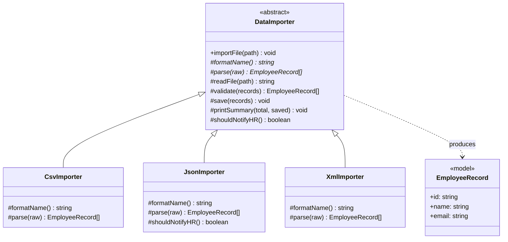
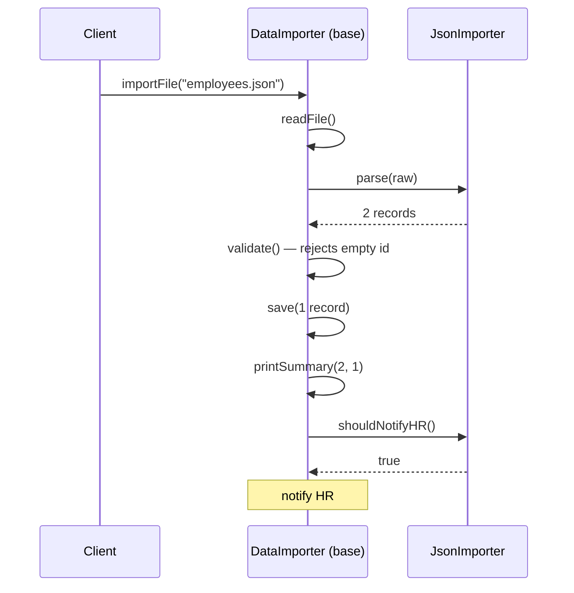

# Template Method — Employee Data Import

> Preview with **Cmd / Ctrl + Shift + V**
>
> **Code:** [`template.ts`](./template.ts) — run with `npm run demo:template`

---

## Problem statement

An HR platform lets companies upload employee files. Different customers send different formats:

| File | Format | Contents |
| ---- | ------ | -------- |
| `employees.csv` | CSV | One valid row, one row with a bad email |
| `employees.json` | JSON | One valid record, one record with an empty ID |
| `employees.xml` | XML (added later) | One valid record |

Every import, whatever the format, must follow the same steps **in this order**:

1. **Read** the file.
2. **Parse** it into employee records — _the only step that depends on the format_.
3. **Validate** — reject rows with a missing ID or an invalid email.
4. **Save** valid rows to the database.
5. **Print a summary** — how many were imported and rejected.
6. **Optionally notify HR** — only the JSON partner wants this.

Adding a new format (XML) must not mean rewriting the pipeline.

---

## Without Template Method

Each format gets its own importer with its own copy of the pipeline:

```typescript
class BadCsvImporter {
  import(path: string) {
    // read → parse CSV → validate → save → summary
  }
}

class BadJsonImporter {
  import(path: string) {
    // read → parse JSON → save → summary
    // validation was never copied over
  }
}
```

The demo shows the result: the CSV importer correctly rejects the bad email, but the JSON importer **saves a record with an empty ID**, because nobody copied the validation step into it. The summary messages also differ between the two.

| Issue | Where it shows up |
| ----- | ----------------- |
| Shared steps duplicated | Read, validate, save, and summary exist once per importer |
| Copies drift apart | The two summary formats no longer match |
| A required step is missing | JSON skips validation |
| Order isn't enforced | Nothing stops an importer from saving before validating |
| New format = full copy | XML would need the whole pipeline pasted a third time |

---

## UML



**Reading the UML:** `importFile()` is the template method — the one public entry point. Methods marked `*` (`formatName`, `parse`) are abstract, so every importer must provide them. `readFile`, `validate`, `save`, and `printSummary` are written once in `DataImporter`. `shouldNotifyHR` is a hook with a default of `false`; only `JsonImporter` overrides it.

---

## The template method

```typescript
abstract class DataImporter {
  importFile(path: string): void {
    const raw = this.readFile(path);
    const records = this.parse(raw);        // abstract — subclass decides
    const valid = this.validate(records);   // shared — cannot be skipped
    this.save(valid);
    this.printSummary(records.length, valid.length);

    if (this.shouldNotifyHR()) {            // hook — default false
      console.log("Notified HR about the import");
    }
  }
}
```

This method is the whole point of the pattern. The order is written once, here, and every importer goes through it. TypeScript has no `final` keyword, so the rule "don't override `importFile`" is stated in a comment in the code.

---

## What each importer writes

Each concrete importer contains **only** what is unique to its format:

```typescript
class CsvImporter extends DataImporter {
  protected formatName() { return "CSV"; }

  protected parse(raw: string): EmployeeRecord[] {
    return raw.split("\n").slice(1).map((line) => {
      const [id, name, email] = line.split(",");
      return { id, name, email };
    });
  }
}

class JsonImporter extends DataImporter {
  protected formatName() { return "JSON"; }

  protected parse(raw: string): EmployeeRecord[] {
    return JSON.parse(raw);
  }

  protected shouldNotifyHR() { return true; }  // uses the hook
}
```

No importer mentions validation, saving, or summaries. They can't forget them, because they never had to write them.

---

## How one import runs



The base class drives the whole sequence. It calls **down** into `JsonImporter` only for the two steps the subclass owns — parsing and the hook.

---

## Adding a new format

The XML payroll system arrives next quarter. The whole change is one class:

```typescript
class XmlImporter extends DataImporter {
  protected formatName() { return "XML"; }

  protected parse(raw: string): EmployeeRecord[] {
    // extract id, name, email from each <employee/> element
  }
}
```

`DataImporter`, `CsvImporter`, and `JsonImporter` are not touched. The XML importer gets validation, saving, the summary, and the correct step order for free.

---

## What you gain

| | Copy-pasted importers | Template Method |
| -- | --------------------- | --------------- |
| Shared steps | Copied into every importer | Written once in `DataImporter` |
| Step order | Each class decides | Fixed by `importFile()` |
| Forgetting validation | Possible (and it happened) | Impossible — the base always runs it |
| Change the summary format | Edit every importer | Edit `printSummary()` once |
| New format | Copy the whole pipeline | Write one `parse()` method |
| Optional behaviour | Ad-hoc `if` per class | A hook with a default |

---

## Other places this exact shape appears

The import pipeline is one example. The same design fits wherever a fixed recipe has a few variable steps:

- **Report generation** — header → body → footer → export; a sales report and an HR report differ only in the body.
- **Test frameworks** — the runner always does setup → test → teardown; you supply the bodies (`beforeEach`, `it`, `afterEach`).
- **Checkout flows** — validate cart → reserve stock → charge → confirm; only the charge step depends on the payment provider.
- **Social login** — redirect → exchange code → fetch profile; Google and GitHub differ only in URLs and profile fields.

If the variants don't share a fixed sequence of steps, you don't need Template Method.

---

## Run it

```bash
npm run demo:template
```

The demo first runs the copy-pasted importers and shows the JSON one saving an invalid record. It then runs the CSV, JSON, and XML importers through the shared pipeline. Every invalid row is rejected, only the JSON import notifies HR, and the database ends up with three valid employees.
