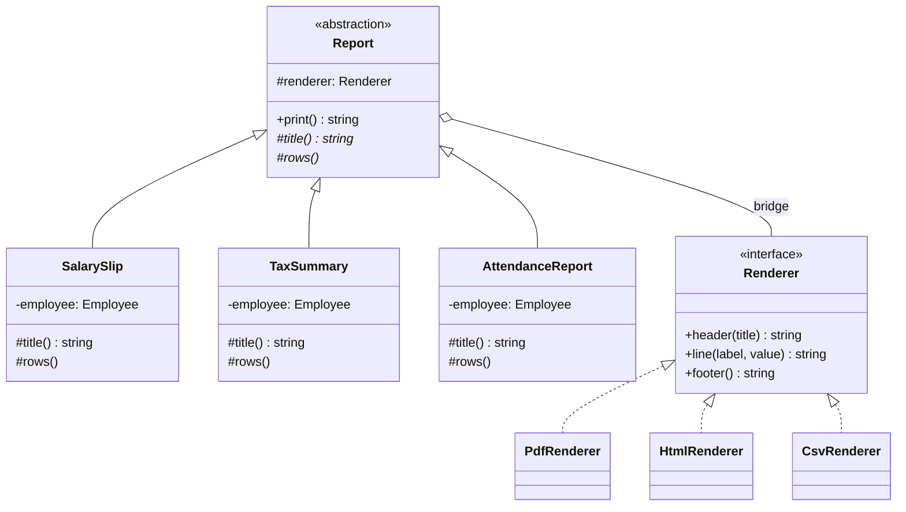
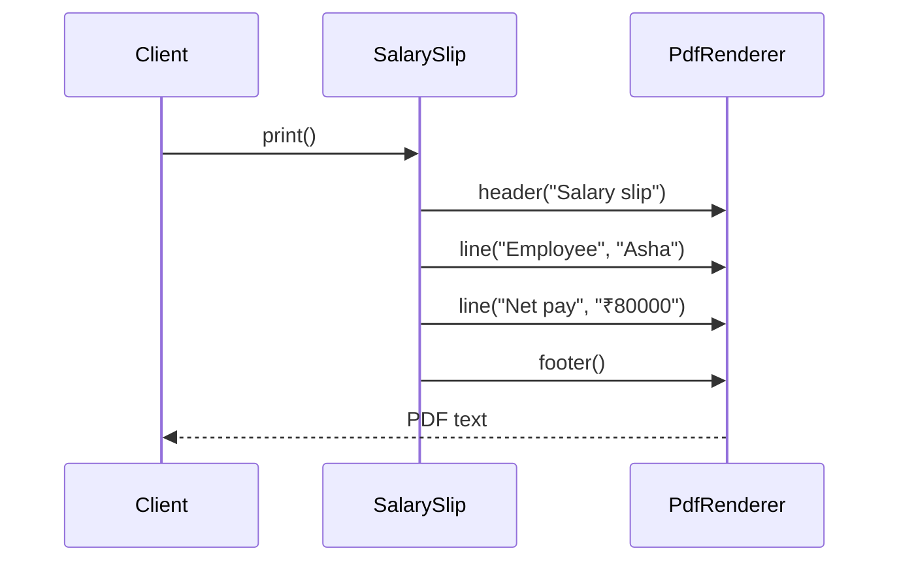

# Bridge — Payroll Reports

> Preview with **Cmd / Ctrl + Shift + V**
>
> **Code:** [`bridge.ts`](./bridge.ts) — run with `npm run demo:bridge`

---

## Problem statement

Payroll prints a document per employee. Two facts vary, and they don't depend on each other:

| | PDF | HTML | CSV, added later |
| -- | --- | ---- | ---------------- |
| **Salary slip** | yes | yes | yes |
| **Tax summary** | yes | yes | yes |
| **Attendance**, added later | yes | yes | yes |

A salary slip always says who the employee is and what the net pay is. A PDF always has a `PDF ::` header and a footer. Those rules must each live in one place. Any report must be drawable in any format, including the ones that don't exist yet.

---

## Without a bridge

```typescript
function badPrint(kind: "salary" | "tax", format: "pdf" | "html", employee: Employee): string {
  if (kind === "salary" && format === "pdf") return /* salary words, PDF syntax */;
  if (kind === "salary" && format === "html") return /* salary words, HTML syntax */;
  if (kind === "tax" && format === "pdf") return /* tax words, PDF syntax */;
  return /* tax words, HTML syntax */;
}
```

The same design as four classes — `SalarySlipPdf`, `SalarySlipHtml`, `TaxSummaryPdf`, `TaxSummaryHtml` — packed into one switch.

| Issue | What it costs |
| ----- | ------------- |
| Count of combinations | 2 × 2 today, 3 × 3 once attendance and CSV arrive |
| "Net pay" | Written once per format |
| The PDF footer | Written once per report |
| A new format | A new branch for every report that already exists |
| A new report | A new branch for every format that already exists |
| Reuse | No renderer object you can hand to the next report |

---

## UML



**Reading the UML:** inheritance goes down, inside one axis. The only link *between* the axes is `Report` holding a `Renderer`. There is no `SalarySlipPdf` class. That missing class is the pattern.

| Role | In this lesson |
| ---- | -------------- |
| Abstraction | `Report` |
| Refined abstraction | `SalarySlip`, `TaxSummary`, `AttendanceReport` |
| Implementor | `Renderer` |
| Concrete implementor | `PdfRenderer`, `HtmlRenderer`, `CsvRenderer` |

---

## The two sides

A renderer knows syntax and nothing about payroll:

```typescript
class PdfRenderer implements Renderer {
  header(title: string): string {
    return `PDF :: ${title}`;
  }

  line(label: string, value: string): string {
    return `  ${label}: ${value}`;
  }

  footer(): string {
    return "PDF :: end";
  }
}
```

A report knows payroll and nothing about PDF:

```typescript
class SalarySlip extends Report {
  protected title(): string {
    return "Salary slip";
  }

  protected rows(): ReadonlyArray<readonly [string, string]> {
    return [
      ["Employee", this.employee.name],
      ["Net pay", `₹${this.employee.netPay}`],
    ];
  }
}
```

`Report.print()` is the only method that talks to both. It asks the report for rows and the renderer to draw each one:

```typescript
print(): string {
  const parts = [this.renderer.header(this.title())];
  for (const [label, value] of this.rows()) {
    parts.push(this.renderer.line(label, value));
  }
  // footer, then join
}
```

---

## Using it

```typescript
const pdf = new PdfRenderer();
const html = new HtmlRenderer();

new SalarySlip(pdf, asha).print();
new SalarySlip(html, asha).print();   // same words, other syntax
new TaxSummary(pdf, asha).print();    // other words, same syntax
```

One salary-slip class. Two drawings. The PDF object is reused for the tax summary, so the footer rule stays in `PdfRenderer`.

---

## Growing one axis at a time

**New format.** CSV implements `Renderer`. `SalarySlip` is not edited:

```typescript
new SalarySlip(new CsvRenderer(), asha).print();
// Salary slip
// Employee,Asha
// Net pay,₹80000
```

**New report.** Attendance extends `Report`. The three renderers are not edited:

```typescript
new AttendanceReport(pdf, asha).print();
new AttendanceReport(html, asha).print();
```

| Change | Classes you add | Classes you edit |
| ------ | --------------- | ---------------- |
| CSV | `CsvRenderer` | none of the reports |
| Attendance | `AttendanceReport` | none of the renderers |
| Both, without a bridge | 5 new combination classes (the grid grows from 4 cells to 9) | the switch that lists every pair |

After both additions the bridge has 6 classes and covers 9 outputs. The switch would have 9 branches.

---

## One print call



The client chose both objects at construction. `print()` does not contain `if (format === "pdf")`.

---

## What you gain

| | Combination switch | Bridge |
| -- | ------------------ | ------ |
| 3 reports × 3 formats | 9 branches or 9 classes | 3 report classes + 3 renderers |
| Change the PDF footer | Edit every PDF case | Edit `PdfRenderer.footer()` |
| Change "Net pay" | Edit every salary case | Edit `SalarySlip.rows()` |
| Hand PDF drawing to a new report | Copy it | Pass the same `PdfRenderer` |

---

## Other places this exact shape appears

- **JDBC** — your code uses `Connection` and `PreparedStatement`. The MySQL or Postgres driver is the implementor loaded underneath. There is no `MysqlSelect` class in your application.
- **A UI toolkit** — `Button` and `Checkbox` are the abstractions. Win32, Cocoa, and GTK are the implementors that actually paint pixels.
- **A drawing tool** — `Circle` and `Rectangle` hold a `DrawingApi`. Vector and raster are the implementors. You do not create `RasterCircle`.
- **A remote and a device** — a basic remote and an advanced remote each hold a `Device`. TV and radio are the devices. You do not create `AdvancedRadioRemote`.

If only one of those axes is real, stop. A single report with a swappable `PdfRenderer` / `HtmlRenderer` is a Strategy, and it should stay one.

---

## Run it

```bash
npm run demo:bridge
```

The demo prints the four-branch version first, then the same salary slip through PDF and HTML, the tax summary through the same PDF renderer, a CSV salary slip, and an attendance report through PDF and HTML. The new format and the new report are each one class.
