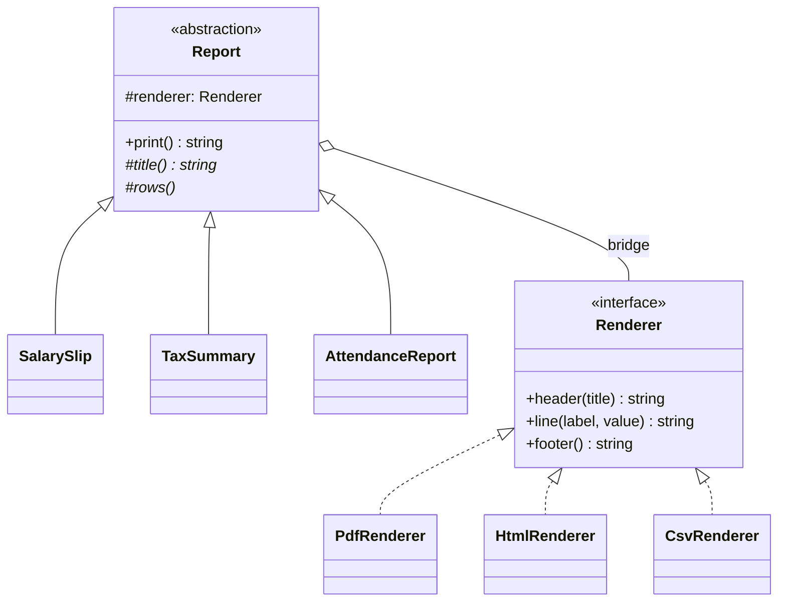
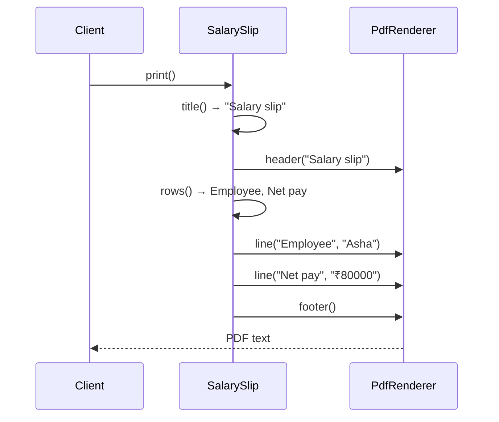

# Bridge Pattern — Understanding the Idea

> Preview with **Cmd / Ctrl + Shift + V**

---

## Definition

> **Bridge** is a structural design pattern that splits a class which would otherwise vary in **two independent directions** into two hierarchies, then connects them with a reference. One side is the **abstraction** (what it means). The other is the **implementor** (how it is carried out). Each side grows without forcing new classes on the other.

In plain words:

> _"A salary slip and a tax summary are different documents. PDF and HTML are different ways to draw any document. Don't create SalarySlipPdf and TaxSummaryHtml. Let the slip hold a renderer."_

---

## A use-case-specific pattern

Bridge is not "prefer composition" in general. Strategy, Adapter, and Decorator already cover most wrapping. Bridge earns a name only when the **cartesian product** of two hierarchies is the problem.

Use it only when **all three** of these are true:

1. **There are two reasons for a class to change**, and they are independent. Report content changes when payroll rules change. Drawing changes when a new file format is required.
2. **Both sides will grow.** A third report and a third format are both expected, not hypothetical.
3. **Every combination is meaningful.** Any report can be drawn by any renderer. You do not have special cases like "tax summaries cannot be HTML".

If only the format varies and there is a single report, that is a Strategy. If you already have a finished PDF library with the wrong method names, that is an Adapter. Bridge is a decision you make **before** the M × N classes exist.

---

## The problem statement

Payroll prints documents for each employee.

| | PDF | HTML | CSV (later) |
| -- | --- | ---- | ----------- |
| **Salary slip** | needed | needed | needed |
| **Tax summary** | needed | needed | needed |
| **Attendance** (later) | needed | needed | needed |

Today that is 2 × 2 = 4 combinations. After the next request it is 3 × 3 = 9. The words on a salary slip must not be copy-pasted once per format. The rules for "how a PDF header looks" must not be copy-pasted once per report.

---

## The issue without a bridge

The straightforward design is one function, or one class, per cell of that table:

```typescript
function badPrint(kind: "salary" | "tax", format: "pdf" | "html", employee: Employee): string {
  if (kind === "salary" && format === "pdf") return pdfSalary(employee);
  if (kind === "salary" && format === "html") return htmlSalary(employee);
  if (kind === "tax" && format === "pdf") return pdfTax(employee);
  return htmlTax(employee);
}
```

What goes wrong:

1. **The class count is the product.** 3 reports and 4 formats are 12 types, not 7. Most of them exist only to pair two facts that don't depend on each other.
2. **Content is copied per format.** "Net pay" is written in the PDF salary function and again in the HTML salary function. A label change is a hunt.
3. **Format rules are copied per report.** The PDF footer is duplicated in every PDF function. A formatting change touches every report.
4. **Either new axis edits the middle.** Adding CSV adds a branch for every report that already exists. Adding attendance adds a branch for every format that already exists. There is no side you can extend alone.
5. **You cannot reuse a format.** There is no `PdfRenderer` to hand to a new report. PDF-ness is trapped inside each combination.

---

## How the bridge fixes it

Two hierarchies, one reference between them:

```typescript
interface Renderer {
  header(title: string): string;
  line(label: string, value: string): string;
  footer(): string;
}

abstract class Report {
  constructor(protected readonly renderer: Renderer) {}

  print(): string {
    // ask the renderer to draw this.title() and this.rows()
  }
}
```

`SalarySlip` and `TaxSummary` only answer "what is my title, what are my rows?". `PdfRenderer` and `HtmlRenderer` only answer "how is a header drawn?". `print()` is the bridge method: it walks the rows and delegates each piece.

```typescript
new SalarySlip(new PdfRenderer(), asha).print();
new SalarySlip(new HtmlRenderer(), asha).print();
new TaxSummary(new PdfRenderer(), asha).print();
```

A `CsvRenderer` is a new implementor. An `AttendanceReport` is a new abstraction. Neither one requires a class on the other side. 3 + 3 = 6 classes cover the 9 combinations.

---

## Standard UML



**Reading the UML:** the left side is "which document". The right side is "which drawing". The aggregation from `Report` to `Renderer` is the bridge — a report is not a PDF, it *uses* a renderer. Subclassing stays inside one side. You never subclass `SalarySlip` into `SalarySlipPdf`.

| Role | Meaning | In our example |
| ---- | ------- | -------------- |
| **Abstraction** | The stable idea, holds the implementor | `Report` |
| **Refined abstraction** | A variation of what it means | `SalarySlip`, `TaxSummary`, `AttendanceReport` |
| **Implementor** | The interface of how it is done | `Renderer` |
| **Concrete implementor** | One way of doing it | `PdfRenderer`, `HtmlRenderer`, `CsvRenderer` |

---

## Core flow



Swap `PdfRenderer` for `HtmlRenderer` and the same calls produce tags. `SalarySlip` does not gain a branch.

---

## Where this shape shows up

Bridge shows up where a product already has two axes and both are expected to grow:

| Domain | Abstraction (what) | Implementor (how) | The explosion it avoids |
| ------ | ------------------ | ----------------- | ----------------------- |
| **JDBC** | `java.sql` statements and connections | MySQL, Postgres, Oracle drivers | One JDBC class per database |
| **UI toolkits** | Button, Checkbox, Menu | Win32, Cocoa, GTK drawing | `WinButton`, `MacButton`, `GtkCheckbox`, … |
| **Drawing editors** | Circle, Rectangle | Vector API, raster API | `VectorCircle`, `RasterRectangle`, … |
| **Device remotes** | Basic remote, advanced remote | TV, radio, set-top box | `AdvancedTvRemote`, `BasicRadioRemote`, … |
| **This lesson** | Salary slip, tax summary, attendance | PDF, HTML, CSV | One class per report-format pair |
| **Messaging** | Alert, digest, receipt | Email, SMS, push | `AlertSms`, `DigestPush`, … |

JDBC is the example to remember in interviews: application code talks to `Connection` and `Statement`. The MySQL driver is loaded underneath. Adding Postgres does not create `MysqlSelect` and `PostgresSelect`.

---

## When NOT to use it

| Situation | Why a bridge is the wrong split | Use this instead |
| --------- | ------------------------------ | ---------------- |
| Only the format changes, and there is one document | There is no second hierarchy | **Strategy** — inject the renderer |
| A library already exists and its methods don't match yours | You are adapting after the fact, not designing two axes | **Adapter** |
| You want to stack extra behaviour on one object | Milk on coffee is not a second hierarchy | **Decorator** |
| One combination is special and shares nothing | Forcing it through `header` / `line` / `footer` hides a real difference | A separate class for that one case |
| You have two variants today and will not add more | The bridge is four types to replace two | Leave them as two classes |

The last row matters. Bridge is a bet that both axes grow. If they don't, you paid for an abstraction you will not extend.

---

## Bridge vs Strategy vs Adapter

| | Bridge | Strategy | Adapter |
| -- | ------ | -------- | ------- |
| How many hierarchies vary? | **Two**, on purpose | **One** algorithm | None — you wrap one existing class |
| When you introduce it | Up front, so the product never appears | When you want to swap one behaviour | After you find two interfaces don't fit |
| What the client composes | A refined abstraction **plus** an implementor | A context **plus** a strategy | An adapter around the adaptee |
| Example | `new SalarySlip(new PdfRenderer())` | `new Checkout(new UpiPayment())` | `new StripeAdapter(new StripeSdk())` |

Strategy is often the implementor side of a bridge. The difference is the abstraction side: `SalarySlip` and `TaxSummary` are real subclasses with their own content. A bridge with a single report class and several renderers has collapsed into Strategy, and that is the right collapse.

---

## SOLID connection

| Principle | How the bridge helps |
| --------- | -------------------- |
| **S** | A report knows its rows. A renderer knows its syntax. Neither knows the other's job |
| **O** | A new report subclasses `Report`. A new format implements `Renderer`. The other hierarchy stays closed |
| **D** | `Report` depends on the `Renderer` interface, not on `PdfRenderer` |

---

## Lesson in this folder

| Resource | What |
| -------- | ---- |
| [bridge.md](./bridge.md) | Payroll reports walkthrough |
| [bridge.ts](./bridge.ts) | A 2×2 switch vs reports composed with renderers |

```bash
npm run demo:bridge
```

---

## One-liner

> _"When two independent axes would multiply into a class per combination, put one hierarchy in the other by reference so each axis can grow alone."_
