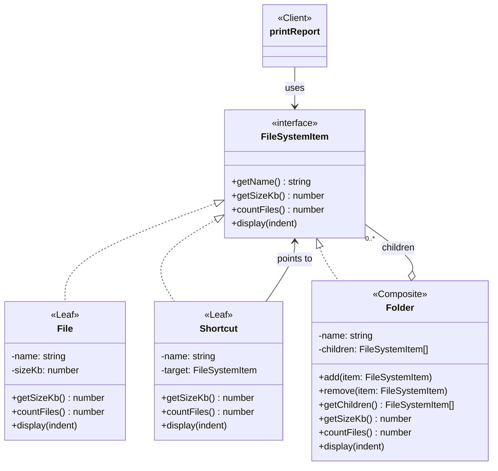
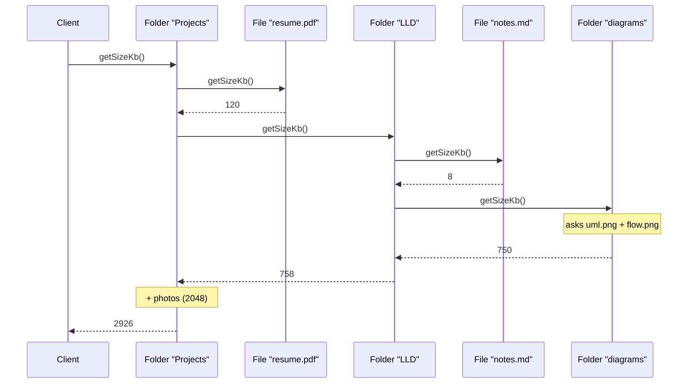

# Composite — File Explorer

> Preview with **Cmd / Ctrl + Shift + V**
>
> **Code:** [`composite.ts`](./composite.ts) — run with `npm run demo:composite`

---

## Problem statement

Build the core of a file explorer. Given this folder tree:

```
Projects/
├── resume.pdf        120 KB
├── LLD/
│   ├── notes.md        8 KB
│   └── diagrams/
│       ├── uml.png   450 KB
│       └── flow.png  300 KB
└── photos/
    └── goa.jpg      2048 KB
```

the explorer must:

1. Display the tree with the size of every file and folder.
2. Report the total size of **anything the user selects** — a single file, a subfolder, or the root.
3. Count all files under any folder, however deep.
4. Add and remove files and entire folders.
5. Support new item types later (shortcuts, zip archives) without rewriting existing code.

This is a textbook Composite use case: folders contain files **and other folders**, and the user expects "size" to work the same way on any of them.

---

## Without Composite

Files and folders are separate classes, and the folder keeps two lists:

```typescript
class BadFolder {
  files: BadFile[] = [];
  folders: BadFolder[] = [];
}
```

Every feature then needs its own traversal:

| Feature | What the code has to do |
| ------- | ----------------------- |
| Total size | Loop files, loop folders, recurse into each folder |
| Count files | Loop files, loop folders, recurse into each folder — again |
| Print tree | Check `instanceof BadFile`, otherwise loop and recurse — again |
| Size of the selected item | Branch: file → read size, folder → call the recursive function |

The same "walk the tree" logic is copied into every function. Add a `Shortcut` type and each of those functions needs a new branch.

---

## UML



**Reading the UML:** `File`, `Shortcut`, and `Folder` all implement `FileSystemItem`. `Folder` stores its children as `FileSystemItem[]`, so a child can be a file, a shortcut, or another folder. `printReport` (the client) depends only on the interface and never checks types.

---

## Leaf vs Composite in code

The **leaf** answers from its own data:

```typescript
class File implements FileSystemItem {
  getSizeKb(): number {
    return this.sizeKb;
  }

  countFiles(): number {
    return 1;
  }
}
```

The **composite** answers by asking its children:

```typescript
class Folder implements FileSystemItem {
  private readonly children: FileSystemItem[] = [];

  getSizeKb(): number {
    return this.children.reduce((sum, child) => sum + child.getSizeKb(), 0);
  }

  countFiles(): number {
    return this.children.reduce((sum, child) => sum + child.countFiles(), 0);
  }
}
```

There is no `instanceof` anywhere. When a child is a folder, its own `getSizeKb()` handles its own children — the recursion comes from the structure, not from a hand-written traversal.

---

## Using it

```typescript
const diagrams = new Folder("diagrams")
  .add(new File("uml.png", 450))
  .add(new File("flow.png", 300));

const lld = new Folder("LLD").add(new File("notes.md", 8)).add(diagrams);

const goaPhoto = new File("goa.jpg", 2048);

const root = new Folder("Projects")
  .add(new File("resume.pdf", 120))
  .add(lld)
  .add(new Folder("photos").add(goaPhoto));

printReport(goaPhoto); // "goa.jpg"  → 2048 KB across 1 file(s)
printReport(diagrams); // "diagrams" → 750 KB across 2 file(s)
printReport(root);     // "Projects" → 2926 KB across 5 file(s)
```

The same `printReport` call works on a file, a subfolder, and the whole tree. That is requirement 2 — "size of anything the user selects" — with no branching.

---

## How one call travels the tree



The client makes **one** call. Each folder forwards it to its children and adds up the answers; each file returns a number.

---

## Adding a new item type

Requirement 5 asks for new item types without rewriting existing code. A `Shortcut` is a new leaf:

```typescript
class Shortcut implements FileSystemItem {
  constructor(private readonly name: string, private readonly target: FileSystemItem) {}

  getSizeKb(): number {
    return 1; // a shortcut stores a pointer, not the file itself
  }

  countFiles(): number {
    return 1;
  }
}

lld.add(new Shortcut("goa-shortcut", goaPhoto));
```

`Folder`, `File`, and `printReport` are not edited. In the "without Composite" version, the size, count, and print functions would each need a new branch.

---

## What you gain

| | Without Composite | With Composite |
| -- | ----------------- | -------------- |
| Size of a file vs a folder | Different code paths | Same call: `item.getSizeKb()` |
| Traversal logic | Copied into every operation | Lives in `Folder`, once per operation |
| New item type | Edit every operation | Add one class |
| Delete a whole subtree | Remove from the right list, by type | `parent.remove(folder)` |
| Type checks | `instanceof` in every function | None |

---

## Other places this exact shape appears

The file explorer is one example. The same design works whenever a container can hold items and other containers:

- **Org chart** — `Employee` (leaf) and `Department` (composite); `getTotalSalary()` on a person or a whole division.
- **Product bundles** — `Product` (leaf) and `ComboPack` (composite); `getPrice()` on one item or a box of boxes.
- **UI layouts** — `Button` (leaf) and `Panel` (composite); `render()` on one widget or the entire screen.
- **Menus** — `MenuItem` (leaf) and `SubMenu` (composite); `render()` on any level of nesting.

If you can't describe your data this way, you don't need Composite.

---

## Run it

```bash
npm run demo:composite
```

The demo first runs the type-checking version, then builds the tree with Composite. It prints the tree, reports sizes for a file, a subfolder, and the root, adds a `Shortcut` without changing `Folder`, and finally removes a whole folder in one call.
