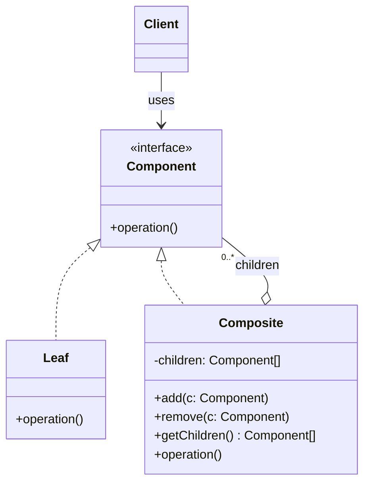

# Composite Pattern — Understanding the Idea

> Preview with **Cmd / Ctrl + Shift + V**

---

## Definition

> **Composite** is a structural design pattern that lets you arrange objects into **tree structures** and then treat a **single object** and a **group of objects** in exactly the same way.

In plain words:

> _"A folder and a file both answer 'what is your size?'. The file returns its own size; the folder asks its children and adds up the answers. The caller never needs to know which one it is talking to."_

---

## A use-case-specific pattern

Most patterns you've seen so far — Strategy, Factory, Singleton — show up in almost any kind of app. **Composite is different.** It solves one specific shape of problem, and if your data doesn't have that shape, the pattern has nothing to offer.

Use Composite only when **both** of these are true:

1. **Your data is a tree (a part–whole hierarchy).** Some items contain other items, and those can contain more items, to any depth.
2. **You want to run the same operation on one item or on a whole group.** "Size of this file" and "size of this folder" should be the same call.

If either is missing — the data is a flat list, or containers and items need completely different operations — Composite is the wrong tool.

---

## The problem statement

You are building a file explorer like Finder or Windows Explorer. It must:

- Show the folder tree with sizes.
- Report the total size of any file or folder.
- Count how many files sit under any folder, at any depth.
- Let users add or remove files and whole folders.

Folders can contain files **and other folders**, nested to any depth.

---

## The issue without Composite

A natural first attempt models files and folders as two unrelated classes:

```typescript
class BadFolder {
  files: BadFile[] = [];
  folders: BadFolder[] = [];
}
```

Now every operation has to handle both types and write its own recursion:

```typescript
function totalSize(folder: BadFolder): number {
  let total = 0;
  for (const file of folder.files) total += file.sizeKb;
  for (const sub of folder.folders) total += totalSize(sub); // recursion #1
  return total;
}

function countFiles(folder: BadFolder): number {
  let count = folder.files.length;
  for (const sub of folder.folders) count += countFiles(sub); // recursion #2
  return count;
}

function print(item: BadFile | BadFolder) {
  if (item instanceof BadFile) { /* ... */ }  // type check
  else { /* loop + recurse again */ }         // recursion #3
}
```

What goes wrong:

1. **Type checks everywhere** — every function asks "is this a file or a folder?" before it can do anything.
2. **Traversal is duplicated** — size, count, print, search, and delete each re-write the same "loop over children and recurse" logic.
3. **New item types are expensive** — adding a `Shortcut` or `ZipArchive` means editing every one of those functions. That breaks Open/Closed.
4. **Callers can't treat items uniformly** — "show the size of whatever the user clicked" needs different code for a file and a folder.

---

## How Composite fixes it

Give files and folders **one shared interface**:

```typescript
interface FileSystemItem {
  getSizeKb(): number;
  countFiles(): number;
  display(indent?: string): void;
}
```

- A **File** (leaf) answers from its own data: `getSizeKb()` returns its size.
- A **Folder** (composite) holds a list of `FileSystemItem` children and answers by asking them: `getSizeKb()` adds up each child's `getSizeKb()`.

Because a folder's children are typed as `FileSystemItem`, a child can be a file or another folder, and the recursion happens naturally. The caller just calls `item.getSizeKb()` on whatever it has.

---

## Standard UML



**Reading the UML:** the key line is the last one. A **Composite** holds children of type **Component** — not of type Leaf. That single choice is what lets a composite contain other composites, which is what turns a flat container into a tree of any depth.

| Role          | Meaning                                         | In our example     |
| ------------- | ----------------------------------------------- | ------------------ |
| **Component** | The shared interface for every node             | `FileSystemItem`   |
| **Leaf**      | A node with no children; does the real work     | `File`, `Shortcut` |
| **Composite** | A node with children; delegates to them         | `Folder`           |
| **Client**    | Code that only talks to Component               | `printReport()`    |

---

## Core flow

```
root.getSizeKb()                     ← Folder "Projects"
   ├── resume.pdf.getSizeKb()  → 120
   ├── LLD.getSizeKb()               ← Folder asks its own children
   │     ├── notes.md          → 8
   │     └── diagrams.getSizeKb()
   │           ├── uml.png     → 450
   │           └── flow.png    → 300
   └── photos.getSizeKb()
         └── goa.jpg           → 2048
                                 = 2926 KB
```

One call at the top travels down the tree. Each folder adds up its children; each file returns a number.

---

## Where Composite is used in real life

Composite only fits tree-shaped domains, so its use cases are specific and easy to recognise:

| Domain | Leaf | Composite | Same operation on both |
| ------ | ---- | --------- | ---------------------- |
| **File systems** | File | Folder | Size, delete, search, permissions |
| **UI component trees** (DOM, React) | `<button>`, `<input>` | `<div>`, a layout component | Render, measure, handle events |
| **Design tools** (Figma, Canva) | Rectangle, text | Group / frame | Move, resize, recolour |
| **Organisation charts** | Employee | Manager / department | Total salary, headcount |
| **Navigation menus** | Menu item | Sub-menu | Render, find by name, enable/disable |
| **E-commerce bundles** | Product | Gift box / combo pack | Total price, total weight |
| **Math expression trees** | Number | `+`, `×` operation | Evaluate, print |
| **Project tasks** | Task | Epic / milestone | Estimated hours, % complete |

The test is the same every time: _"Can a container hold items **and other containers**, and do I want to ask both the same question?"_

---

## When NOT to use Composite

| Situation | Why Composite doesn't fit |
| --------- | ------------------------- |
| A flat list (a cart of products with no bundles) | No nesting, so there is nothing to recurse into — a plain array is enough |
| Containers and items need very different operations | Forcing them into one interface leaves methods that don't make sense on one side |
| A graph where items can have several parents or form cycles | Composite assumes each node has one parent; cycles cause infinite recursion |
| Only one level of grouping, forever | A simple `group.items` loop is clearer |

---

## Safety vs transparency

Where should `add()` and `remove()` live?

| Choice | How | Trade-off |
| ------ | --- | --------- |
| **Safety** (used here) | Only `Folder` has `add`/`remove` | You can't accidentally call `add()` on a file, but code that adds children must know it has a `Folder` |
| **Transparency** | Put `add`/`remove` on the shared interface | Every item looks identical, but `File.add()` must throw an error |

This lesson uses the safety approach — TypeScript then stops you from adding a child to a file at compile time.

---

## Composite vs Decorator

Both hold references to objects of the same interface, so they look alike in UML.

| | Composite | Decorator |
| -- | --------- | --------- |
| Holds | **Many** children | **One** wrapped object |
| Purpose | Represent a part–whole tree | Add behaviour to one object |
| Typical result | `folder.getSize()` = sum of children | `milk(coffee).cost()` = coffee cost + extra |

---

## SOLID connection

| Principle | How Composite helps |
| --------- | ------------------- |
| **O** | New node types (e.g. `Shortcut`) are new classes; `Folder` and client code stay unchanged |
| **L** | Any `FileSystemItem` — file, folder, or shortcut — can stand in wherever the interface is expected |
| **S** | Each class handles only its own part: files report themselves, folders delegate |

---

## Lesson in this folder

| Resource | What |
| -------- | ---- |
| [composite.md](./composite.md) | File explorer walkthrough |
| [composite.ts](./composite.ts) | Bad type-checking traversal vs Composite |

```bash
npm run demo:composite
```

---

## One-liner

> _"Composite lets a container and the items inside it share one interface, so a single call works on one item or an entire tree — use it only when your data really is a tree."_
