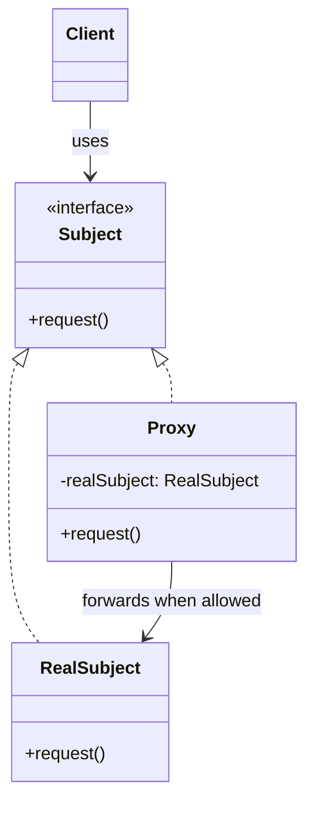
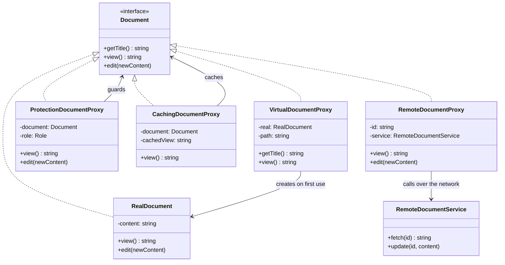

# Proxy Pattern — Understanding the Idea

> Preview with **Cmd / Ctrl + Shift + V**

---

## Definition

> **Proxy** is a structural design pattern that puts a **stand-in** in front of a real object. The stand-in has the **same interface**, so callers cannot tell the difference. Before (or instead of) forwarding a call, the proxy controls **when**, **whether**, or **how** that call happens.

In plain words:

> _"The document list shows titles. The 50MB file is not loaded until someone opens it. Guests who open it are turned away. The screen that displays it never knows a proxy is in the way."_

---

## A use-case-specific pattern

Proxy is not a general "wrap something" tool — that is Decorator. **Proxy is for controlling access to an object you already have.** The object is correct; the problem is the cost, the permissions, the network, or the repeated work around using it.

Use a proxy only when **both** of these are true:

1. **Callers should keep using the same interface.** A document is still `view()` and `edit()`, whether or not a proxy sits in front.
2. **Something about reaching the real object must be controlled** — delay it, refuse it, cache it, or send it somewhere else.

If you are adding a new feature (milk on a coffee), that is a Decorator. If you are translating a foreign API, that is an Adapter.

---

## The problem statement

A company portal lists documents (handbook, payroll, leave policy) and lets people open or edit them.

- Each file is large. Loading it from disk or cloud storage is slow.
- The list page only needs **titles**. Almost nobody opens every file.
- Roles differ: **guests** cannot read, **employees** can read, **admins** can edit.
- One document is stored on **another server**. The UI should still look like a normal method call.
- Opening the same remote document twice should not hit the network twice.

The `Document` class itself should stay a document: it loads, it returns text, it saves. It should not know about roles, caches, or HTTP.

---

## The issue without Proxy

The first version constructs every document while rendering the list, and every screen checks permissions itself:

```typescript
// List page — user has not opened anything yet
const docs = [
  new RealDocument("Handbook", "/docs/handbook.pdf"), // disk read
  new RealDocument("Payroll", "/docs/payroll.xlsx"),  // disk read
  new RealDocument("Policy", "/docs/policy.pdf"),     // disk read
];

// Page A remembers the rule
if (role === "ADMIN") document.edit(text);

// Page B forgets, and writes straight through
document.edit(text);
```

What goes wrong:

1. **Work happens too early.** Three heavy files load so the page can show three titles.
2. **The rule is copy-pasted.** Every new screen must remember guests cannot view and employees cannot edit. One forgotten check is a real bug — the demo shows a screen that saves anyway.
3. **The real class grows the wrong responsibilities.** Putting roles, caching, and HTTP inside `RealDocument` mixes "what a document is" with "who may touch it" and "where it lives".
4. **Remote calls leak into the UI.** Every screen builds URLs and handles the network, instead of calling `view()`.
5. **Repeated calls repeat the cost.** Nothing remembers that this document was just fetched.

---

## How Proxy fixes it

Define one interface. The real document implements it. Each proxy implements it too and holds the real document (or knows how to reach it):

```typescript
interface Document {
  getTitle(): string;
  view(): string;
  edit(newContent: string): void;
}
```

The list holds `Document`s. A virtual proxy's `getTitle()` returns the name it was given and does not touch disk. The first `view()` creates the real document. A protection proxy's `edit()` throws unless the role is `ADMIN`, so no screen can forget the check — the check is not in the screen.

---

## The four types

Same structure every time: **proxy and subject share an interface, proxy forwards (or refuses)**. What changes is the reason for the stand-in.

| Type | What it controls | In this lesson | Typical trigger |
| ---- | ---------------- | -------------- | --------------- |
| **Virtual** | **When** the real object is created | `VirtualDocumentProxy` loads the file on first `view()` / `edit()` | The real object is expensive and might never be used |
| **Protection** | **Whether** the call is allowed | `ProtectionDocumentProxy` checks the role | Different callers have different rights |
| **Caching** | **How often** the real work runs | `CachingDocumentProxy` stores the last `view()` | The result is expensive and stays valid for a while |
| **Remote** | **Where** the real object lives | `RemoteDocumentProxy` turns `view()` into `GET /documents/:id` | The subject is on another machine |

A fifth name you will see is **smart reference** (also called a logging or reference-counting proxy): the proxy adds bookkeeping around the call, such as "log every edit" or "delete the file when the last handle is dropped". Caching is the smart-reference case this lesson implements. A logging proxy would be the same shape with a `console.log` before the forward.

### Virtual

```typescript
view(): string {
  return this.load().view(); // new RealDocument(...) only the first time
}
```

`getTitle()` does not call `load()`. That split is the whole point: cheap operations stay cheap.

### Protection

```typescript
edit(newContent: string): void {
  if (this.role !== "ADMIN") {
    throw new Error(`${this.role} cannot edit documents. Admins only.`);
  }
  this.document.edit(newContent);
}
```

Guests fail on `view()`. Employees can `view()` but fail on `edit()`. Admins pass through. `RealDocument` stays unaware.

### Caching

The first `view()` forwards and stores the string. The second returns the stored string and does not touch the wrapped document. `edit()` clears the cache so the next view cannot serve stale text.

### Remote

The proxy is created with an id. It holds no file contents. `view()` calls `service.fetch(id)` and `edit()` calls `service.update(id, content)`. Callers write ordinary method calls; the network stays inside the proxy.

---

## Standard UML



**Reading the UML:** the client depends on `Subject`, never on `RealSubject`. Both the real object and the proxy implement `Subject`. Inside `request()`, the proxy does its extra work (load, check, cache, or send over the network) and then calls the same method on the real subject — or refuses to.

| Role | Meaning | In our example |
| ---- | ------- | -------------- |
| **Subject** | The shared interface | `Document` |
| **RealSubject** | The object that does the real work | `RealDocument`, or `RemoteDocumentService` behind the remote proxy |
| **Proxy** | Same interface, controls access | `VirtualDocumentProxy`, `ProtectionDocumentProxy`, `CachingDocumentProxy`, `RemoteDocumentProxy` |
| **Client** | Code that only sees Subject | The portal pages |

### All four types on one interface



Because every proxy **is a** `Document`, they wrap each other. The demo ends with a protection proxy around a caching proxy around a remote proxy. The page still calls `view()` once.

---

## Where each type shows up

These are specific. If the situation is not about controlling access to an existing object, it is not a proxy.

| Type | Real situations |
| ---- | --------------- |
| **Virtual** | Photo gallery thumbnails (full image loads on click); IDE tabs that parse a file only when focused; a map that fetches tiles for the visible area |
| **Protection** | Admin vs member checks in front of a repository; a read-only view of a shared document; an API gateway rejecting a token before the handler runs |
| **Caching** | Memoised database reads; HTTP cache in front of a slow endpoint; a CDN in front of an origin server |
| **Remote** | gRPC / REST client stubs; database drivers; Firebase or Supabase clients that look like local objects |
| **Smart reference** | Logging every call to a payment service; closing a file when the last reader drops it; ORM objects that mark themselves dirty on write |

The test: _"Do I need a stand-in that looks like the real object, because reaching the real object is expensive, forbidden, remote, or worth remembering?"_

---

## When NOT to use Proxy

| Situation | Why a proxy is the wrong tool |
| --------- | ----------------------------- |
| You want to **add** behaviour the object didn't have (a discount, a topping) | That is a **Decorator**. A proxy controls access; it should not invent a new feature |
| The wrapped object has the **wrong interface** | That is an **Adapter**. A proxy must share the subject's interface |
| You only need the check in one place, once | An `if` at that call site is clearer than a class |
| The "expensive" object is cheap to create | A virtual proxy hides a cost that isn't there |
| You need a different algorithm, not a guard around one | That is **Strategy** |

---

## Proxy vs Decorator vs Adapter

All three wrap an object. The difference is **why**.

| | Proxy | Decorator | Adapter |
| -- | ----- | --------- | ------- |
| Interface vs the wrapped object | **Same** | **Same** | **Different** (the wrapper matches what the client wants) |
| Purpose | Control access to the real object | Add behaviour in layers | Translate one API into another |
| Does the client know? | Ideally no — a stand-in | Usually yes — it stacks toppings on purpose | Yes — it asked for its own interface |
| Example | Load the file on first open | `Milk(Sugar(Coffee))` | Stripe's `createCharge` behind `pay()` |

---

## SOLID connection

| Principle | How Proxy helps |
| --------- | --------------- |
| **S** | `RealDocument` only loads and saves. Roles, caching, and HTTP live in their own proxies |
| **O** | A new control (logging, rate limiting) is a new proxy. `RealDocument` stays closed |
| **L** | Any proxy can stand in wherever a `Document` is expected |
| **D** | Pages depend on `Document`, not on disk paths, roles, or the remote service |

**A caution:** a protection proxy that only hides a check can spread false confidence. The real service must enforce the same rule. The proxy makes the happy path honest; it is not a security boundary by itself if callers can still reach `RealDocument` directly.

---

## Lesson in this folder

| Resource | What |
| -------- | ---- |
| [proxy.md](./proxy.md) | Document portal walkthrough, one section per type |
| [proxy.ts](./proxy.ts) | Eager loading and copy-pasted checks vs the four proxies |

```bash
npm run demo:proxy
```

---

## One-liner

> _"A proxy is a stand-in with the real object's interface that controls when, whether, or how a call gets through — virtual, protection, caching, and remote are four reasons to put one there."_
