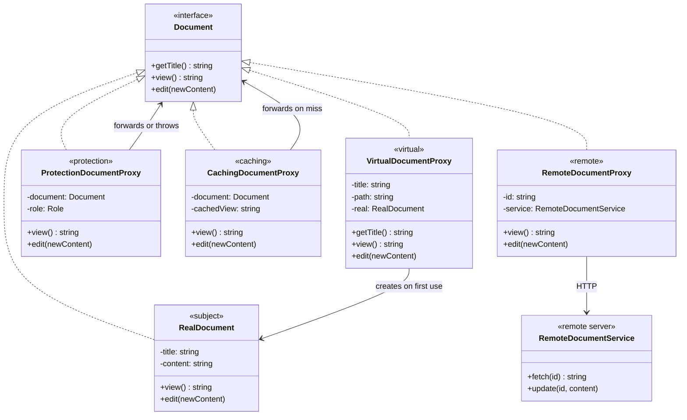
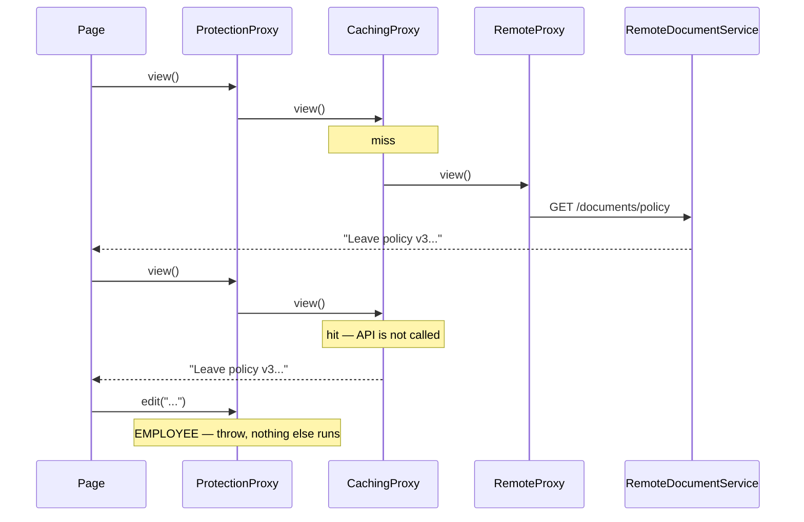

# Proxy — Company Document Portal

> Preview with **Cmd / Ctrl + Shift + V**
>
> **Code:** [`proxy.ts`](./proxy.ts) — run with `npm run demo:proxy`

---

## Problem statement

The portal lists company documents and lets people open or edit them.

| Document | Where it lives | Who needs it |
| -------- | -------------- | ------------ |
| Handbook, Payroll, Policy | Large files on disk | The list shows all three titles; a person usually opens one |
| Leave policy | A service on another server | Employees read it often; only admins change it |

Rules:

- **Guest** — cannot read or edit.
- **Employee** — can read, cannot edit.
- **Admin** — can read and edit.

The document class must stay a document. Roles, caching, network calls, and "don't load this yet" are not its job.

This is a proxy problem because every requirement is about **reaching** the document, not about changing what a document is.

---

## Without a proxy

```typescript
const docs = [
  new RealDocument("Handbook", "/docs/handbook.pdf"),
  new RealDocument("Payroll", "/docs/payroll.xlsx"),
  new RealDocument("Policy", "/docs/policy.pdf"),
];
```

That runs at list-render time. All three files hit the disk before anyone clicks.

Permissions live at the call site:

```typescript
if (role === "ADMIN") document.edit(text); // page A

document.edit(text); // page B forgot the check — the file is saved
```

| Issue | What happens |
| ----- | ------------ |
| Eager load | Titles cost three disk reads |
| Copy-pasted checks | One screen skips the check and writes |
| Remote details in the UI | Every page builds `GET /documents/:id` itself |
| No memory of the last fetch | The same policy is downloaded again on every open |
| Fat document class | If you push all of this into `RealDocument`, it learns about roles, HTTP, and caches |

---

## UML



**Reading the UML:** one interface, four stand-ins. `VirtualDocumentProxy` is the only one that creates a `RealDocument`, and it does that lazily. The other three wrap any `Document` (or, for the remote proxy, a service). The protection and caching arrows point at `Document`, not `RealDocument`, which is what lets them wrap a remote proxy too.

---

## 1. Virtual proxy — delay the expensive object

The list needs titles. It does not need bytes.

```typescript
class VirtualDocumentProxy implements Document {
  private real: RealDocument | null = null;

  getTitle(): string {
    return this.title; // no disk access
  }

  view(): string {
    return this.load().view();
  }

  private load(): RealDocument {
    if (!this.real) {
      this.real = new RealDocument(this.title, this.path);
    }
    return this.real;
  }
}
```

```typescript
const library: Document[] = [
  new VirtualDocumentProxy("Handbook", "/docs/handbook.pdf"),
  new VirtualDocumentProxy("Payroll", "/docs/payroll.xlsx"),
  new VirtualDocumentProxy("Policy", "/docs/policy.pdf"),
];

library.map((doc) => doc.getTitle()); // no disk reads
library[0].view();                     // Handbook loads now
library[0].view();                     // same object, no second read
```

Payroll and Policy are never loaded, because nobody opened them.

**Use it for:** image galleries (thumbnail now, full image on click), editor tabs, map tiles, video posters.

---

## 2. Protection proxy — one place for the rule

```typescript
class ProtectionDocumentProxy implements Document {
  view(): string {
    if (this.role === "GUEST") {
      throw new Error("Guests cannot view documents.");
    }
    return this.document.view();
  }

  edit(newContent: string): void {
    if (this.role !== "ADMIN") {
      throw new Error(`${this.role} cannot edit documents. Admins only.`);
    }
    this.document.edit(newContent);
  }
}
```

| Caller | `view()` | `edit()` |
| ------ | -------- | -------- |
| Guest | throws | throws |
| Employee | forwards | throws |
| Admin | forwards | forwards |

Page A and page B both hold a `Document`. Neither contains an `if (role)`. Forgetting the check is no longer possible, because the object they were given will not forward the call.

**Use it for:** admin-only repository methods, a read-only share link, an API gateway that rejects a bad token before the handler runs.

The real service should still enforce the rule. A proxy only helps callers who go through it. Anyone holding the raw `RealDocument` bypasses it.

---

## 3. Caching proxy — don't pay twice

```typescript
class CachingDocumentProxy implements Document {
  private cachedView: string | null = null;

  view(): string {
    if (this.cachedView !== null) return this.cachedView;
    this.cachedView = this.document.view();
    return this.cachedView;
  }

  edit(newContent: string): void {
    this.document.edit(newContent);
    this.cachedView = null; // the saved string is now stale
  }
}
```

Wrapped around the remote proxy, the first `view()` prints `GET /documents/policy`. The second prints `Cache hit` and does not. An edit clears the cache so the next view cannot show the old policy.

**Use it for:** repeated database reads, a slow HTTP GET, a CDN in front of an origin.

Don't cache something that changes on every call (a clock, a payment) or something the user must see live.

---

## 4. Remote proxy — local calls, remote object

```typescript
class RemoteDocumentProxy implements Document {
  view(): string {
    return this.service.fetch(this.id); // GET /documents/:id
  }

  edit(newContent: string): void {
    this.service.update(this.id, newContent); // PUT /documents/:id
  }
}

const policy: Document = new RemoteDocumentProxy("policy", "Policy", service);
policy.view();
```

The client stores a `Document`. It never sees a URL. The proxy is the only class that knows the policy lives on another machine.

**Use it for:** gRPC stubs, database drivers, SDK clients that feel local.

---

## They stack, because the interface is the same



```typescript
const portal: Document = new ProtectionDocumentProxy(
  new CachingDocumentProxy(new RemoteDocumentProxy("policy", "Policy", service)),
  "EMPLOYEE",
);
```

Order matters. Protection is on the outside, so a refused `edit()` never reaches the cache or the network. The cache sits in front of the remote proxy, so a second view stops there.

---

## What you gain

| | Call sites do the work | Proxy |
| -- | ---------------------- | ----- |
| Showing 1,000 titles | Loads 1,000 files | Virtual proxy loads the one that is opened |
| Permission rule | Copied per screen, sometimes missing | One class, every screen goes through it |
| Second open of a remote doc | Second network call | Caching proxy returns the saved result |
| Document stored on another server | UI builds HTTP calls | Remote proxy, UI calls `view()` |
| Adding a log of every edit | Edit `RealDocument` | A new proxy around it; the document stays as it was |

---

## Other places this exact shape appears

- **Virtual** — a photo grid. The cell knows the filename; the full bitmap is created on click.
- **Protection** — `adminRepo.deleteUser()` wrapped so a member token never reaches the database method.
- **Caching** — `getUser(id)` memorises the row until an update for that id arrives.
- **Remote** — a payment SDK. `charge(amount)` in your process is an HTTP call in the proxy.

If the stand-in does not share the real object's methods, you want an Adapter. If it adds a new feature rather than controlling access, you want a Decorator.

---

## Run it

```bash
npm run demo:proxy
```

The demo first renders a library by constructing every `RealDocument`, then shows a second screen skipping the permission check. After that it runs each proxy on its own — virtual, protection, caching, remote — and finishes with all three access-control proxies stacked around the leave policy.
